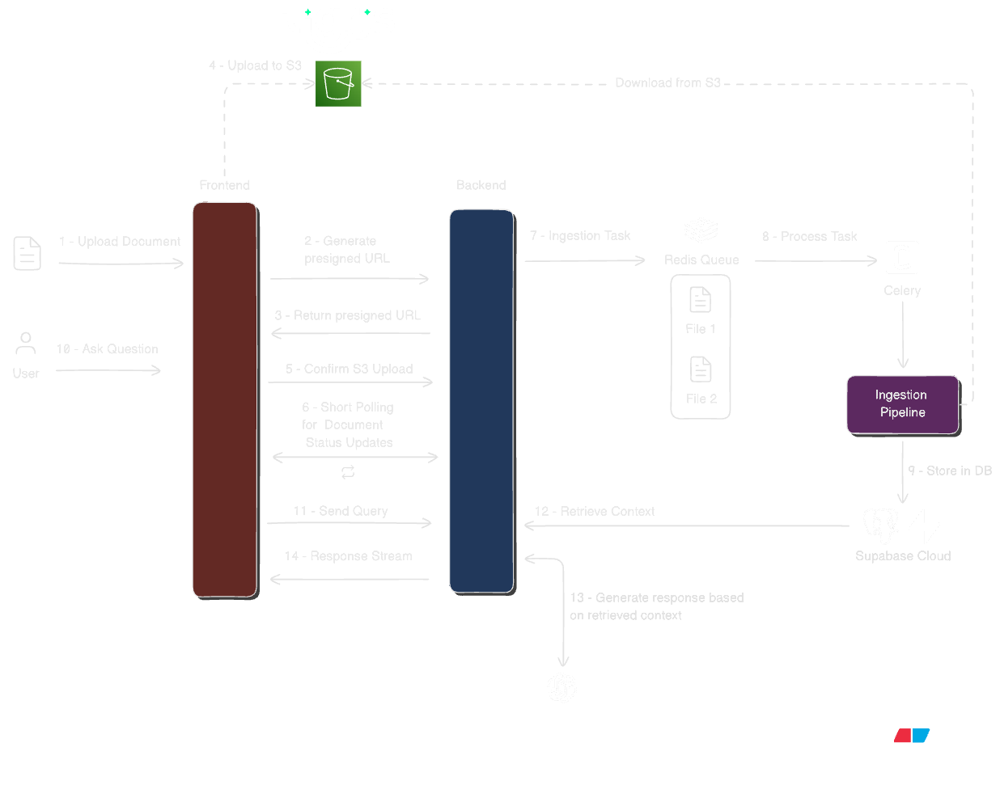

# KnowledgeDock

KnowledgeDock is a RAG app for chatting with your own documents. You create a project, add PDFs, Word files, slides or web pages, and ask questions. Answers stream back with citations to the file and page they came from.

This repository is the backend: the API, the ingestion worker, the database schema and the evaluation. The front end is in `production-rag-client`.

> **Status:** the app was deployed on AWS (ECS Fargate, ECR, CloudFront) with the front end on Vercel. The AWS free credits have run out, so it now runs locally only. See [Run locally](#run-locally) and [Architecture: Deployment](documentation/ARCHITECTURE.md#deployment).

## Evaluation

I measured retrieval and answer quality on [Open RAGBench](https://huggingface.co/datasets/vectara/open_ragbench): 40 arXiv papers (20 with questions, 20 distractors) and 206 questions, including 20 that have no answer in the documents. Settings were tuned on a dev split with paired significance tests, and a held-out test split is kept for a single final run.

- The top retrieved chunk is from the right paper **98%** of the time, but from the right section only **71%**. Finding the document is easy; finding the place in it is the hard part.
- The **Cohere reranker adds 26 points** of Hit@1 (44% → 71%, p < 0.001), the largest effect measured.
- **Hybrid keyword + vector search added nothing** on this corpus, and a larger candidate pool improved recall without a significant gain in what reaches the model.
- **Questions about figures are the weak spot:** the right chunk reaches the model 76% of the time, against 91% for text-only questions.
- **Images are 87% of the generator's input tokens.** Sending them at low detail would cut input cost by about 70%.

Full method, results and next steps: [Evaluation](documentation/EVALUATION.md). The generation runs that choose the final settings are waiting for the Cohere API key's monthly limit to reset.

## What it does

- **Projects.** Each project has its own documents, chats and retrieval settings. Queries are scoped to the user's own projects ([two routes are exceptions](documentation/KNOWN_LIMITATIONS.md#security)).
- **Ingestion in the background.** Files go straight from the browser to S3 through presigned URLs. A Celery worker then parses them (Unstructured `hi_res`, with tables and images), chunks them by section, writes an LLM summary for chunks with tables or images, and stores embeddings in pgvector. The UI shows each step's progress.
- **Chat with citations.** Replies stream over Server-Sent Events. Every answer carries citations to the chunk, file and page it used.
- **Tunable retrieval per project.** Vector or hybrid search, optional multi-query expansion, Cohere reranking, and settings for the number of candidates and chunks in context.
- **Two agent modes.** A simple RAG agent, or a supervisor that can also search the web. Both run an input guardrail first (toxicity, prompt injection, personal data).
- **Built to run as a service.** API and worker scale separately, there are per-user daily message limits, structured JSON logs, and LangSmith traces linked to each message.

## Tech stack

| | |
|---|---|
| Front end | Next.js, TypeScript, Tailwind CSS, Clerk |
| Backend | FastAPI, Celery, Redis |
| Data | Supabase Postgres with pgvector and full-text search; Tigris (S3-compatible) object storage |
| AI | OpenAI (`text-embedding-3-large`, `gpt-4o-mini`, `gpt-4o`), Cohere Rerank, LangChain, LangGraph, Unstructured, LangSmith |
| Evaluation | Open RAGBench, Ragas, custom retrieval metrics with paired tests |
| Deployment | Docker; previously AWS ECS Fargate + ECR + CloudFront, Vercel for the front end |

## How it works



**Adding a document**

1. The client asks the API for a presigned upload URL and uploads the file directly to S3. Web pages skip this step.
2. The client confirms the upload, and the API queues an ingestion task.
3. A Celery worker downloads the file (or scrapes the page), partitions it, chunks it, summarises chunks with tables or images, and stores the embeddings in Supabase.
4. The client polls the document's status until it is `completed`.

**Asking a question**

1. The client sends the message to the streaming endpoint.
2. The API checks the daily quota, saves the message, and loads the project's agent type and the recent chat history.
3. The agent runs the guardrail, then retrieves context from the project's documents: search, rerank, and keep the top chunks.
4. The model answers from those chunks, and the reply streams back with its citations.

## Run locally

**You need:** Python 3.11+, [Poetry](https://python-poetry.org/), Node.js, Docker, the [Supabase CLI](https://supabase.com/docs/guides/cli), and the system libraries the PDF parser uses (on macOS: `brew install poppler tesseract libmagic`).

**Accounts and keys:** OpenAI, Clerk, an S3-compatible bucket, and ScrapingBee are required. Cohere (reranking), Tavily (web search) and LangSmith (tracing) are optional.

**1. Configure `server/.env`:**

| Variable | What |
|---|---|
| `SUPABASE_API_URL`, `SUPABASE_SERVICE_KEY` | From `supabase status` after the database starts |
| `CLERK_SECRET_KEY` | Clerk backend key |
| `DOMAIN` | The front-end origin Clerk tokens are issued for, e.g. `http://localhost:3000` |
| `S3_BUCKET_NAME`, `AWS_REGION`, `AWS_ACCESS_KEY_ID`, `AWS_SECRET_ACCESS_KEY`, `AWS_ENDPOINT_URL_S3` | Object storage |
| `REDIS_URL` | `redis://localhost:6379/0` for the local Redis |
| `OPENAI_API_KEY`, `SCRAPINGBEE_API_KEY` | Required |
| `COHERE_API_KEY`, `TAVILY_API_KEY`, `LANGSMITH_TRACING`, `LANGSMITH_API_KEY`, `LANGSMITH_PROJECT` | Optional |

**2. Start the backend** (from `server/`, each in its own terminal):

```bash
poetry install
./start_db.sh        # local Supabase; applies the migrations in supabase/migrations
./start_redis.sh     # Redis in Docker
./start_server.sh    # API on http://localhost:8000
./start_worker.sh    # Celery worker for ingestion
```

Alternatively, `docker compose up` runs Redis, the API and the worker in containers. The database still runs separately.

**3. Start the front end** (from `production-rag-client/`): set `NEXT_PUBLIC_API_URL=http://localhost:8000`, `NEXT_PUBLIC_CLERK_PUBLISHABLE_KEY` and `CLERK_SECRET_KEY` in `.env`, then run `npm install && npm run dev`.

**Sign-up note:** user rows are created by a Clerk webhook calling `POST /api/users/create-user`. Locally, either point the webhook at your machine with a tunnel such as ngrok, or insert a row into `users` with your Clerk user id.

**To run the evaluation:** `poetry install --with eval`, then follow [Evaluation: Reproduce](documentation/EVALUATION.md#reproduce).

## Documentation

| Doc | Read it for |
|---|---|
| [Architecture](documentation/ARCHITECTURE.md) | How the parts fit together, the request flow, and the deployment |
| [Evaluation](documentation/EVALUATION.md) | Benchmark, method, results and next steps |
| [Ingestion Pipeline](documentation/INGESTION_PIPELINE.md) | Parsing, chunking, summaries and embeddings |
| [Retrieval Pipeline](documentation/RETRIEVAL_PIPELINE.md) | Search strategies, rank fusion and reranking |
| [Generation Pipeline](documentation/GENERATION_PIPELINE.md) | Agents, guardrails, prompts and streaming |
| [Database](documentation/DATABASE.md) | Schema, vector and keyword search, indexes |
| [API Endpoints](documentation/API_ENDPOINTS.md) | Every route, grouped by user flow |
| [Known Limitations](documentation/KNOWN_LIMITATIONS.md) | What is missing and what I would fix next |
