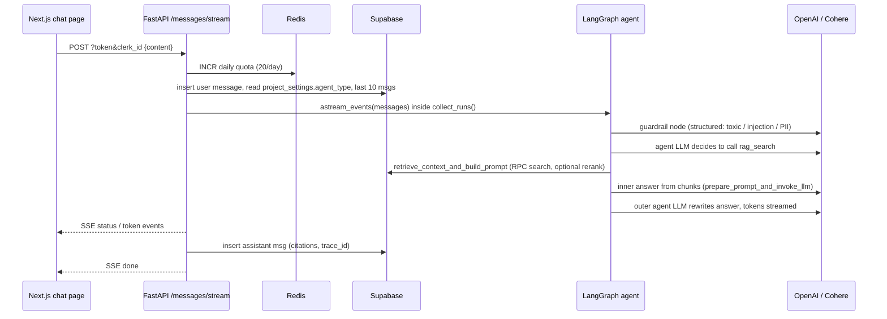

# KnowledgeDock Architecture (Phase 0 recon)

A short map of how the system works today, plus the gaps that will block the upgrade phases. Deeper detail lives in [`documentation/`](../documentation/): [API](../documentation/API_ENDPOINTS.md), [DB](../documentation/DATABASE.md), [ingestion](../documentation/INGESTION_PIPELINE.md), [retrieval](../documentation/RETRIEVAL_PIPELINE.md), [generation](../documentation/GENERATION_PIPELINE.md).

Repos: `production-rag-server` (this repo) and `production-rag-client` (Next.js). Each one has its own git history.

## 1. Stack

| Layer | What |
|---|---|
| Front end | Next.js 16, React 19, Tailwind, Clerk auth |
| API | FastAPI + uvicorn (`src/server.py`), structlog JSON logs |
| Background jobs | Celery (threads pool, concurrency 4) on Redis; Redis also holds the rate-limit counters |
| Storage | Supabase Postgres + pgvector; Tigris (S3-compatible) for raw files |
| Parsing | Unstructured `0.18.11` (`hi_res`, table structure on); ScrapingBee for URLs |
| LLM / agents | LangChain `1.2.9` `create_agent` + LangGraph `StateGraph`; OpenAI `text-embedding-3-large` (1536 dims), `gpt-4o-mini` / `gpt-4o`; Cohere `rerank-english-v3.0`; Tavily / DuckDuckGo web search |
| Tracing | LangSmith (env-var driven) |

## 2. Request flow (chat)

The UI uses the **streaming** route. The non-stream `POST .../messages` route still exists but follows the same steps.

- **Route**: `src/routes/projects.py:505` (`stream_message`). It hard-codes `gpt-4o`; the non-stream route at `:380` hard-codes `gpt-4o-mini`.
- **Agent choice**: `project_settings.agent_type`. `simple` → `src/agents/simple_agent/agent.py` (guardrail → agent with one `rag_search` tool, recursion limit 5). `agentic` → `src/agents/supervisor_agent/agent.py` (guardrail → supervisor with `rag_search` (itself a sub-agent) and `search_web` tools). New projects default to **`agentic`**.
- **Chat history**: the last 10 messages are pasted into the system prompt as text (`get_chat_history`, `projects.py:332`). There is no checkpointer and no `thread_id`.
- **Retrieval**: `src/rag/retrieval/index.py:10` `retrieve_context_and_build_prompt(project_id, query)`:
  1. Loads `project_settings` and every document id in the project.
  2. Runs one strategy from `search.py`: `basic` (vector RPC), `hybrid` (vector + Postgres FTS RPC fused with weighted RRF, k=60), `multi-query-vector` / `multi-query-hybrid` (an LLM writes query variations, then RRF across them).
  3. Optional Cohere rerank (`reranker.py`; falls back silently on error).
  4. Caps to `final_context_size` (`index.py:53`).
  5. `context_builder.py` splits the chunks into texts, tables (HTML), images (base64) and citations `{chunk_id, document_id, filename, page}`.
- **Generation**: `src/rag/retrieval/utils.py` `prepare_prompt_and_invoke_llm` builds a system prompt with the chunks and tables plus a fixed refusal sentence, then calls `chat_llm`. Its output goes back to the agent as a `ToolMessage`, and the agent LLM writes the final answer from it. So there are **two generation calls per answer**.
- **Citations** are added to graph state through `Command(update={"citations": ...})` and stored on the message.

## 3. Ingestion

`src/rag/ingestion/index.py:process_document`, run by the Celery task `perform_rag_ingestion` (`src/services/celery.py:59`).

1. **Upload**: `POST /api/projects/{pid}/file/upload-url` returns a presigned S3 PUT URL. The client uploads directly to S3, then `POST .../file/confirm` queues the Celery task. URLs go through `POST .../urls` and are scraped with ScrapingBee.
2. **Partition** (`partition.py`): downloads to `/tmp`, then calls `partition_pdf(strategy="hi_res", infer_table_structure=True, extract images as base64)`. Also handles docx, pptx, txt and md; URLs use `partition_html`.
3. **Chunk** (`chunking.py`): `chunk_by_title(max_characters=3000, new_after_n_chars=2400, combine_text_under_n_chars=500)`. Sizes are in characters and hard-coded.
4. **Summarise** (`summarization.py`): chunks that contain a table or image get a GPT-4o-mini "search index" (questions + keywords). It **replaces `content`**, which is the text that gets embedded and FTS-indexed. The raw text, table HTML and images stay in `original_content` and are what the generator sees. Page = `chunk.metadata.page_number`, else `chunk_idx + 1` (`summarization.py:89`).
5. **Embed and store** (`vectorization.py`): embeds `content` in batches of 10, then inserts one row at a time into `document_chunks`.
6. **Status**: each step updates `project_documents.processing_status` and `processing_details`. The front end polls these.

## 4. Data model (pgvector)

Migrations are in `supabase/migrations/`.

- `users(clerk_id)` → `projects` → `project_settings` (1:1) and `project_documents` → `document_chunks`
- `projects` → `chats` → `messages(citations, trace_id)` → `feedback(rating, category, comment)`
- `document_chunks`: `content`, `original_content json`, `type json`, `page_number int`, `chunk_index`, `embedding vector(1536)` with an **HNSW cosine** index, and `fts tsvector` generated from `content` with a **GIN** index.
- RPCs: `vector_search_document_chunks(query_embedding, filter_document_ids, match_threshold, chunks_per_search)` and `keyword_search_document_chunks(query_text, filter_document_ids, chunks_per_search)`.
- **Namespace = project.** Every search is filtered by the project's document ids.
- `project_settings` defaults (set in `create_project`, `projects.py:79`): `rag_strategy=basic`, `chunks_per_search=10`, `final_context_size=5`, `similarity_threshold=0.3`, `number_of_queries=5`, `reranking_enabled=true`, `vector_weight=0.7`, `keyword_weight=0.3`, `agent_type=agentic`, `embedding_model=text-embedding-3-large` (stored but not used).

## 5. LangSmith

- Wired up only through env vars (`LANGSMITH_TRACING`, `LANGSMITH_ENDPOINT`, `LANGSMITH_API_KEY`, `LANGSMITH_PROJECT`). LangChain traces every graph, LLM and tool run automatically.
- The stream route wraps the run in `collect_runs()` (`projects.py:585`) and saves the root run id as `messages.trace_id`.
- Nothing else is sent: no run tags or metadata (project, strategy, model), no datasets or experiments, and no feedback. Thumbs up/down goes only to the Supabase `feedback` table.

## 6. Deployment (AWS)

From `Dockerfile`, `docker-compose.yaml` and `../readmes/docker_notes.md`:

- **One image** (`python:3.13`, poetry, poppler, tesseract, libmagic) built from `server/` and pushed to **ECR** with a manually bumped tag.
- **ECS Fargate**, two services from that image: **api** (`uvicorn src.server:app :8000`) and **worker** (`celery -A src.services.celery:celery_app worker --pool=threads`). They scale independently.
- **No ALB**: CloudFront sits in front of the API task's public IP, so the origin has to be edited by hand after each redeploy.
- **Managed outside AWS**: Supabase Cloud (Postgres + pgvector), Tigris (objects, through `AWS_ENDPOINT_URL_S3`), Clerk, OpenAI, Cohere, ScrapingBee, Tavily, LangSmith.
- **Release**: manual. Build, push, update the task definition, then force a new deployment. There is no CI/CD.
- **Local**: `start_db.sh` (Supabase CLI), `start_redis.sh`, `start_server.sh`, `start_worker.sh`, or `docker compose up`.
- **To confirm**: where the front end is hosted, and which Redis runs in production (ElastiCache is recommended in the notes, but the cloud `REDIS_URL` is commented out).

**Env vars** (checked at import in `src/config/index.py`):

- Required: `SUPABASE_API_URL`, `SUPABASE_SERVICE_KEY`, `CLERK_SECRET_KEY`, `DOMAIN`, `S3_BUCKET_NAME`, `AWS_REGION`, `AWS_ACCESS_KEY_ID`, `AWS_SECRET_ACCESS_KEY`, `AWS_ENDPOINT_URL_S3`, `REDIS_URL`, `OPENAI_API_KEY`, `SCRAPINGBEE_API_KEY`
- Optional: `COHERE_API_KEY`, `HF_TOKEN`, `TAVILY_API_KEY`, `LANGSMITH_*`, `LOG_LEVEL`, `POD_NAME`
- Client: `NEXT_PUBLIC_API_URL`, `NEXT_PUBLIC_CLERK_PUBLISHABLE_KEY`, `CLERK_SECRET_KEY`

## 7. Gaps and blockers

### Blocks Phase 1 (FinanceBench eval)

1. **No config injection.** Retrieval reads settings only from the DB row by `project_id`. A YAML config needs an override path (for example a `settings` argument on `retrieve_context_and_build_prompt`).
2. **Chunking and embeddings are hard-coded.** Chunking is by-title only, sized in characters (`chunking.py`). The embedding model is fixed in `services/llm.py`, and `project_settings.embedding_model` is ignored. The schema is fixed at `vector(1536)`, so another model must output 1536 dims (for example `text-embedding-3-small`) or needs a new column or table plus index.
3. **Page numbers are unreliable.** If metadata is missing, the page silently falls back to `chunk_idx + 1`. By-title chunks can span pages, but only one page is stored. Both would corrupt Hit@k against the gold page.
4. **No rank-level retrieval output.** Only the capped chunks (`final_context_size=5`) come back, so Hit@k for k above the cap and MRR over the full list can't be measured.
5. **Double generation.** The inner answer and the outer agent rewrite are separate calls. Faithfulness must be judged against the retrieved chunks, not the inner answer, and the rewrite can drift or drop the standard refusal sentence.
6. **The default agent has web search.** `agent_type=agentic` can call Tavily, which would leak outside knowledge into the eval. Eval must force `simple`.
7. **Guardrail false refusals.** The LLM guardrail rejects anything it thinks contains "PII". Questions that name executives may be refused, which inflates the false refusal rate. It also adds an LLM call to every query's latency and cost.
8. **Silent fallbacks.** Cohere rerank failures fall back to no rerank without any signal in the output. `similarity_threshold=0.3` can return zero chunks. Config reads `COHERE_API_KEY`, but `.env` sets `CO_API_KEY`; this only works because the Cohere SDK falls back to that variable.
9. **Bulk ingestion.** Ingestion is tied to S3, Celery and `project_documents`, which has a foreign key to `users.clerk_id`. A FinanceBench loader needs an eval user and project, and should call `process_document` (or its steps) directly. `hi_res` plus one LLM summary per table chunk on about 80+ 10-K PDFs will be slow and cost money. Summarisation also makes 2 DB round trips per chunk.
10. **Models are hard-coded in routes** (`gpt-4o` for stream, `gpt-4o-mini` for non-stream). Eval needs the generator model to come from config.

### Broken or untested

- `evaluation/scripts/collect_data.py` imports `retrieve_context`, which no longer exists. It also hard-codes a project id, and its RAGAS dataset is general knowledge, not finance.
- **There are no tests**: no pytest, no `tests/`. Importing `src.config.index` raises if any env var is missing, and the Supabase, S3, Redis, Cohere and OpenAI clients are all built at import time. Unit tests will need env stubs and mocks (or lazy clients).
- Client: `next.config.ts` sets `typescript.ignoreBuildErrors: true`, and lint was removed from the build.

### Security and hygiene (not blocking)

- The stream route trusts `clerk_id` from the query string, and `GET /api/projects/{id}/settings` has no auth (also noted in `../readmes/10_known_gaps_and_hardening.md`). CORS is `*` with credentials. The service-role Supabase key bypasses RLS everywhere.
- **The git remote URL for this repo has a GitHub personal access token embedded in it** (`.git/config`). Revoke the token and switch the remote to SSH.
- There is no `.env.example`. Dependencies use version ranges instead of pins. `ragas` and `ipykernel` sit in prod dependencies. There is no client Dockerfile and no CI. Local Python is 3.11, but the image uses 3.13.
