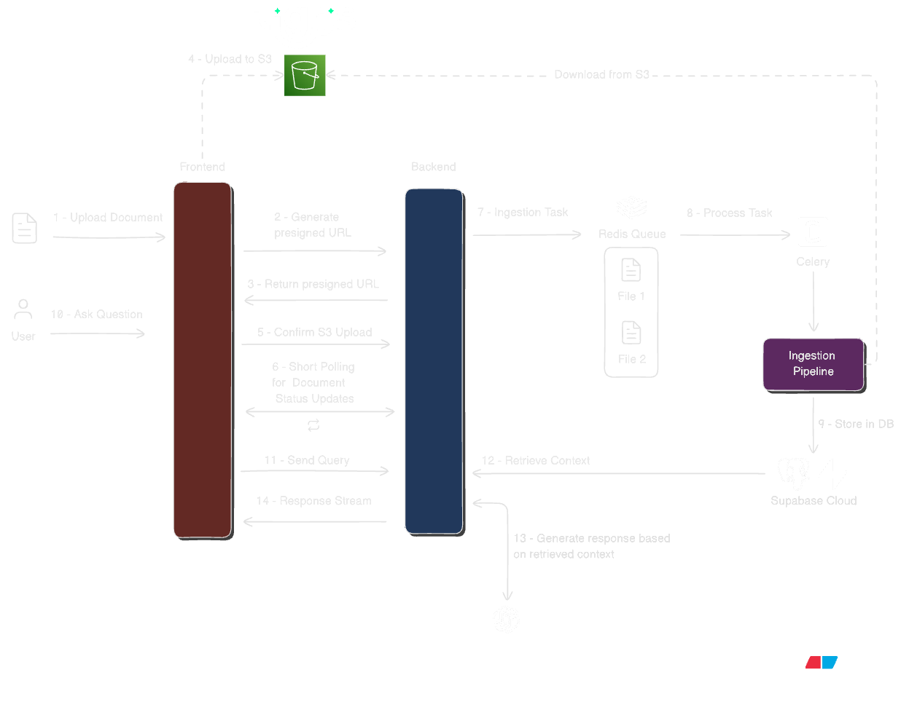
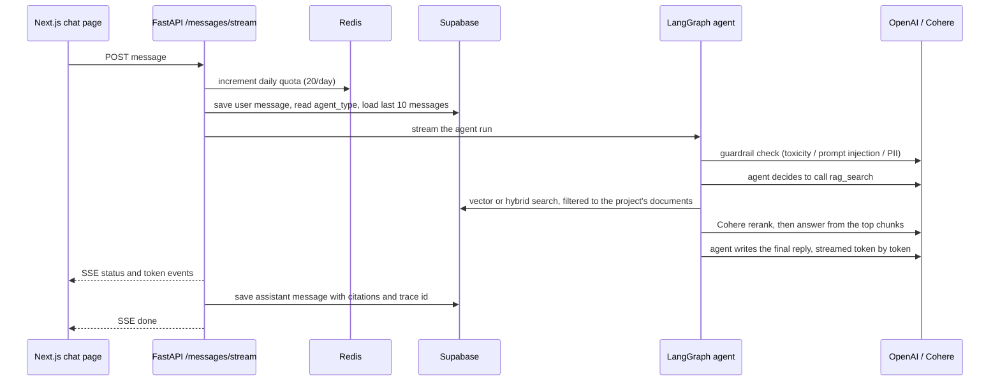

# Architecture

How the parts of KnowledgeDock fit together. The pipeline docs go deeper: [ingestion](INGESTION_PIPELINE.md), [retrieval](RETRIEVAL_PIPELINE.md), [generation](GENERATION_PIPELINE.md), [database](DATABASE.md), [API](API_ENDPOINTS.md).

The code lives in two repositories: `production-rag-server` (this one: API, worker, database migrations, evaluation) and `production-rag-client` (the Next.js front end).

## Stack

| Layer | What |
|---|---|
| Front end | Next.js 16, React 19, Tailwind CSS, Clerk for sign-in |
| API | FastAPI on uvicorn (`src/server.py`), structured JSON logs with structlog |
| Background jobs | Celery workers (threads pool) with Redis as the broker. Redis also holds the per-user daily message counters. |
| Storage | Supabase Postgres with pgvector for chunks and metadata; Tigris (S3-compatible) for uploaded files |
| Parsing | Unstructured `0.18.11` (`hi_res` strategy, table structure, images as base64); ScrapingBee for web pages |
| Models | OpenAI `text-embedding-3-large` (shortened to 1,536 dimensions), `gpt-4o-mini` and `gpt-4o`; Cohere rerank |
| Agents | LangChain `create_agent` and LangGraph `StateGraph`; Tavily or DuckDuckGo for web search |
| Tracing | LangSmith |
| Evaluation | Open RAGBench, Ragas, custom retrieval metrics and paired tests ([Evaluation](EVALUATION.md)) |

## A chat message, end to end

The chat UI uses the streaming route.

- **Two kinds of agent.** `project_settings.agent_type` picks the agent. `simple` has one tool, `rag_search`. `agentic` (the default for new projects) is a supervisor that can call `rag_search` and `search_web`.
- **Two generation calls per answer.** `rag_search` produces an answer from the retrieved chunks with `gpt-4o-mini`, and then the agent writes the reply the user sees (`gpt-4o` on the streaming route). See [Generation Pipeline](GENERATION_PIPELINE.md).
- **Chat history** is the last 10 messages, added to the system prompt as text.
- **Citations** (chunk, document, file name, page) travel through the graph state and are saved with the assistant message.
- **Tracing.** LangChain sends every graph, model and tool run to LangSmith. The root run id is stored on the message as `trace_id`, so a reply in the UI can be traced back to its run.

## A document, end to end

1. The browser asks the API for a presigned URL, uploads the file straight to S3, then confirms the upload. Web pages skip S3.
2. The API queues a Celery task, and a worker runs `process_document`: partition, chunk, summarise chunks with tables or images, embed, store.
3. Each step updates `project_documents.processing_status`, and the UI polls it every few seconds.

Details are in [Ingestion Pipeline](INGESTION_PIPELINE.md).

## Deployment

**Current status: runs locally only.** The app was deployed on AWS and worked end to end. The AWS free credits have run out, so the backend is no longer hosted.

How it was deployed:

- **One Docker image** (`python:3.13` with poetry, poppler, tesseract and libmagic) built from `server/` and pushed to Amazon ECR.
- **Two ECS Fargate services** from that image: `api` (uvicorn) and `worker` (Celery). They scale separately, so a burst of uploads doesn't slow down chat.
- **CloudFront** in front of the API task. There was no load balancer, to stay within the free tier, so the origin had to be updated by hand after each redeploy.
- **Managed services outside AWS:** Supabase Cloud, Tigris, Clerk, OpenAI, Cohere, ScrapingBee, Tavily, LangSmith.
- **Front end** on Vercel.
- **Releases were manual:** build, push, update the task definition, force a new deployment. There was no CI/CD.

For local setup, see [Run locally](../README.md#run-locally).

## Related docs

- [Server README](../README.md)
- [Known Limitations](KNOWN_LIMITATIONS.md)
- [Evaluation](EVALUATION.md)
