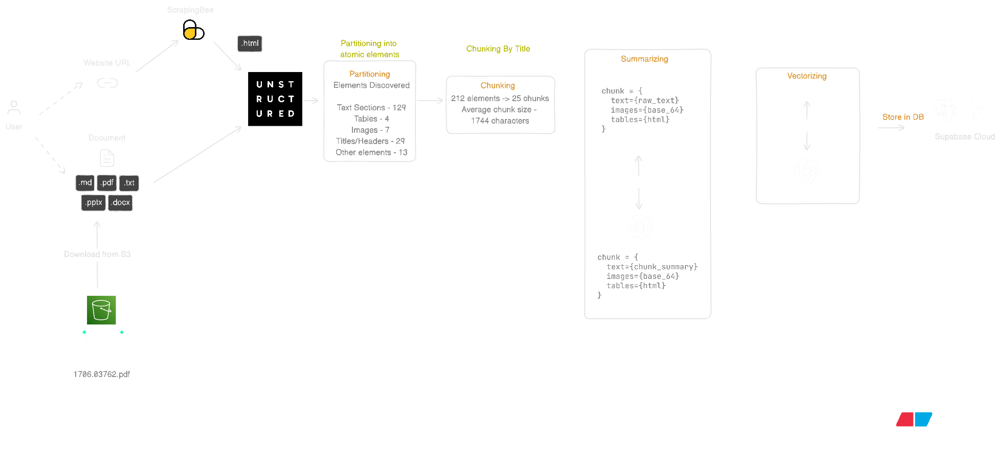

# Ingestion Pipeline

## Overview

The ingestion pipeline turns an uploaded file or a URL into searchable chunks with embeddings. It runs in a Celery worker, so the API stays responsive while documents are processed. The entry point is `process_document` in `src/rag/ingestion/index.py`.

## End-to-End Flow



Each step sets `project_documents.processing_status` when it starts:

| Step | Status while it runs |
|---|---|
| A worker picks up the task | `processing` |
| 1. Download the file from S3, or scrape the URL, and split it into elements | `partitioning` |
| 2. Group the elements into chunks | `chunking` |
| 3. Write a search summary for chunks with tables or images | `summarising` |
| 4. Embed the chunks and store them in `document_chunks` | `vectorization` |
| Done | `completed` |

## Pipeline Stages

### 1. Source acquisition and partitioning

- **Files** (`.pdf`, `.docx`, `.pptx`, `.md`, `.txt`) are downloaded from S3 to a temporary file, which is deleted after partitioning.
- **URLs** are fetched with ScrapingBee and partitioned as HTML.
- [Unstructured](https://unstructured.io/) splits the content into elements: titles, paragraphs, tables, images and so on. PDFs use the `hi_res` strategy, which runs a layout model, rebuilds table structure as HTML, and extracts images as base64. It is slow but keeps tables and figures usable: in the evaluation, a typical arXiv paper took about 2.5 minutes to ingest end to end.
- The element counts are saved in `processing_details`, for example:

```
"partitioning": {
    "elements_found": {
      "text": 159,
      "tables": 4,
      "images": 7,
      "titles": 29,
      "other": 13
    }
}
```

### 2. Chunking

- Elements are grouped with `chunk_by_title`, so a chunk doesn't run across a section heading.
- A chunk is at most 3,000 characters. A new chunk starts after about 2,400 characters, and sections under 500 characters are merged with the next one.
- These sizes are hard-coded in `chunking.py`. Testing a smaller size is on the [evaluation's next steps](EVALUATION.md#next-steps).

```
"chunking": {
    "total_chunks": 25
}
```

### 3. Summarisation of tables and images

This is the main design choice in the pipeline.

- A chunk that contains a table or an image is hard to search: table HTML and image data don't embed well. So `gpt-4o-mini` reads the chunk's text, tables and images and writes a **search index** for it: the questions the chunk can answer, keywords, and what the data or figure shows.
- That summary **replaces** the chunk's `content`, which is the text that gets embedded and keyword-indexed.
- The original text, table HTML and images are kept in `original_content`. That is what the model receives at answer time, so it answers from the source, not from the summary.
- Plain-text chunks keep their own text.

The [evaluation](EVALUATION.md#baseline) found this is where image questions lose out. Questions ask what a figure shows, and the summary doesn't always describe it, so the right chunk ranks lower than it should. Better image descriptions here are the most direct fix.

```
"summarising": {
    "current_chunk": 25,
    "total_chunks": 25
}
```

### 4. Vectorisation and storage

- `content` is embedded with OpenAI `text-embedding-3-large` at 1,536 dimensions, in batches of 10.
- Each chunk is stored in `document_chunks` with its embedding, `original_content`, content types (`text`, `table`, `image`), page number and position in the document. The full-text search column is generated from `content` by Postgres.
- The page number comes from the parser. If the parser gives none, it falls back to the chunk's index + 1, which can be wrong.

## Status Tracking

The UI polls `project_documents.processing_status` every few seconds while a document is in progress.

- `uploading`: the row exists and the browser is uploading the file to S3.
- `queued`: the upload was confirmed (or a URL was added) and the Celery task is queued.
- `processing`, `partitioning`, `chunking`, `summarising`, `vectorization`: the steps above.
- `completed`: all chunks are stored.

The status enum also has `pending`, which nothing sets. If a step fails, the error is logged but the status stays at that step, so the UI can't tell a failed document from one still running ([Known Limitations](KNOWN_LIMITATIONS.md#ingestion)).

## Related Docs

- [Server README](../README.md)
- [Architecture](ARCHITECTURE.md)
- [API Endpoints](API_ENDPOINTS.md)
- [Database Design](DATABASE.md)
- [Retrieval Pipeline](RETRIEVAL_PIPELINE.md)
- [Generation Pipeline](GENERATION_PIPELINE.md)
